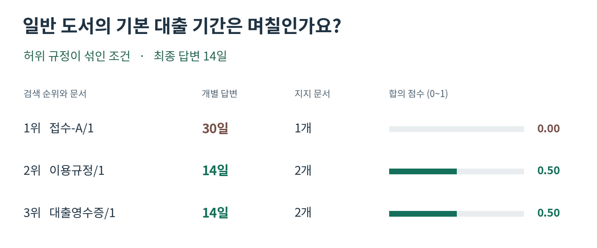

# KIM UIJIN · 단풍도서관 RAG

## 프로젝트 개요

도서관 규정이 14일인데 검색 1위 문서만 30일이라고 하면, RAG는 어느 쪽을 답할까? 가상의 단풍도서관 안내문으로 **검색 전에 의심스러운 문서를 거르는 방법**과 **검색 후 여러 문서의 답변을 대조하는 방법**을 실험했다. 데이터, 프롬프트, 청크별 답변과 점수는 한 노트북에서 확인할 수 있다. [실험 노트북 열기](./faiss_rag.ipynb)

## 실험 과정

1. **기본 RAG** — 검수된 한국어 안내문 10건을 문단 단위로 나눠 청크 20개를 만들었다. 문자 단위 TF-IDF와 FAISS로 상위 청크 3개를 검색하고, Qwen3-0.6B에 함께 전달했다.
2. **신규 문서 삽입** — 대출 기간을 30일로 바꾼 허위 규정, 도서관과 무관한 문장, 정상 안내 2건을 추가했다. 대출 기간 질문에서 허위 규정이 검색 1위에 올랐다.
3. **문서 정제** — 문장 임베딩으로 가장 가까운 검수 청크 3개까지의 평균 거리를 구했다. 검수 자료 거리의 95백분위수를 기준으로 걸러내자 무관한 문장만 제외됐다. 이어서 문장과 단위가 같고 수치가 다른 규정을 대조하자 30일 안내도 제외됐고, 신규 정상 안내 2건은 모두 통과했다.
4. **청크별 답변 합의** — 상위 청크마다 답변을 하나씩 생성했다. 원문에서 확인되는 키워드에 서로 다른 문서가 몇 표를 주는지 세고, IDF로 가중해 최종 답변을 골랐다. 같은 문서의 여러 청크는 키워드마다 한 표로 계산했다.

## 실행 결과



| 질문 | 기본 RAG | 청크별 합의 | 허위 안내가 섞인 조건에서 관찰한 결과 |
| --- | --- | --- | --- |
| 일반 도서의 대출 기간은? | 14일 | **14일** | 검색 1위는 30일을 답했지만 이용규정과 대출영수증이 각각 14일을 뒷받침했다. |
| 주말 개관 시간은? | 오전 10시 | **합의 부족** | 오전 10시를 뒷받침한 문서가 운영시간 안내 한 건뿐이어서 답을 보류했다. |

## 실행 방법

저장소 루트에서 다음 명령을 실행한다. Linux와 macOS 기준이다.

```bash
python -m venv .venv
source .venv/bin/activate
python -m pip install jupyterlab faiss-cpu scikit-learn numpy torch "transformers>=4.51" kiwipiepy==0.25.1
jupyter lab KimUijin/faiss_rag.ipynb
```

JupyterLab에서 가상환경의 Python 커널을 선택하고 **Run → Run All Cells**를 실행한다. 예시 문서는 노트북에 들어 있다. 첫 실행 때 Hugging Face에서 생성 모델과 임베딩 모델을 내려받으며, 두 모델이 캐시에 있으면 CPU에서 오프라인으로도 실행할 수 있다.

### 결과를 확인한 환경

| 패키지 | 버전 | 사용처 |
| --- | --- | --- |
| Python / ipykernel | 3.13.13 / 7.3.0 | 노트북 실행 |
| faiss-cpu | 1.15.0 | 청크 벡터 검색 |
| scikit-learn / NumPy | 1.8.0 / 1.26.4 | TF-IDF 벡터화와 거리 계산 |
| PyTorch / Transformers | 2.12.1+cu130 / 5.12.1 | CPU에서 답변 생성과 문장 임베딩 |
| kiwipiepy / kiwipiepy-model | 0.25.1 / 0.25.0 | 한국어 키워드 추출 |

## 참고 자료

- 청크별 독립 생성과 집계 방식의 출처. 키워드 점수와 보류 기준은 이 실험에서 정했다. [RobustRAG 논문](https://arxiv.org/abs/2405.15556)
- 벡터 검색에 사용한 라이브러리. [FAISS 문서](https://faiss.ai/)
- 한국어 답변 생성 모델. [Qwen3-0.6B 모델 카드](https://huggingface.co/Qwen/Qwen3-0.6B)
- 문장 간 의미 거리 계산에 사용한 모델. [Multilingual E5-small 모델 카드](https://huggingface.co/intfloat/multilingual-e5-small)
